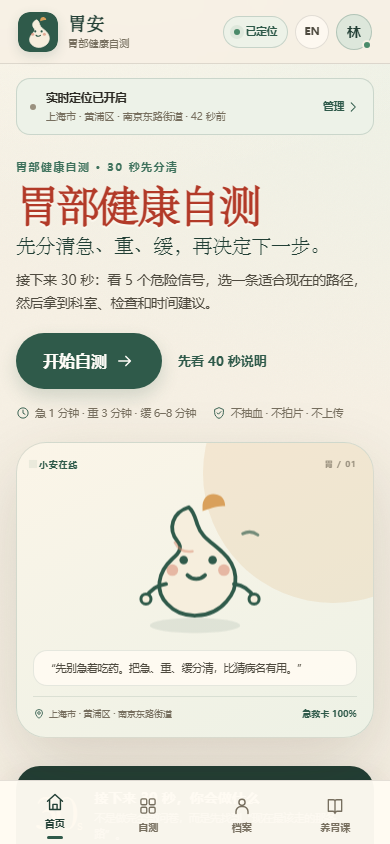
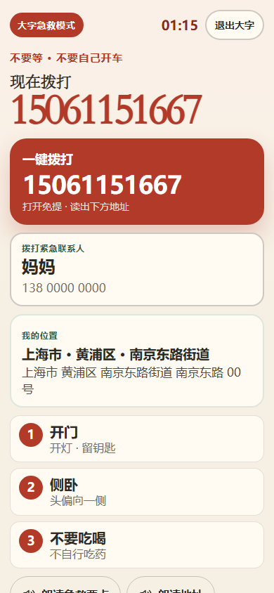

# 胃安 · TummyBuddy

> **v0.3.0（2026-11-24）本次更新**
>
> 1. **定位解析**：BigDataCloud → Photon → OpenStreetMap 三通道依次补齐省 / 市 / 区 / 街道，缺字段自动用下一家补；成功一次即写入本地缓存，同一坐标再次打开不再请求。
> 2. **语音输入**：只在开始录音时取一次底稿，中间结果从底稿重算，不再把上一轮的文本重复拼进去。
> 3. **人体图重建**：九分区（右上腹 / 心窝 / 左上腹 / 右腰 / 脐周 / 左腰 / 右下腹 / 下腹 / 左下腹）+ 整个肚子，透明命中层覆盖整块区域，编号与下方图例一一对应。
> 4. **结果页大字模式**：结果页右上角“大字模式”，正文、按钮、分级横幅整体放大，双栏改单栏；开关状态会记住。
> 5. **小安陪伴智能体**：右下角常驻的小安，点开可对话。内置 20+ 条健康教育答案（挂什么科、反酸、胃镜、幽门螺杆菌、饮食、情绪、孕期、报告、中医、减肥等），命中呕血 / 黑便 / 胸痛大汗 / 晕厥等词会直接弹急救卡。
> 6. **拍照参考线**：舌象、面部、手掌、病历四类取景框都加了虚线对准层（舌尖伸出 1/3、眼睛对准虚线、五指张开露手腕、文字占满画面）。
>
> 演示参数：`?demo=1&screen=mild&step=1`（人体图）、`?demo=1&screen=home&anp=1`（小安）、`?demo=1&screen=result&kind=mild&case=reflux&resultbig=1`（大字结果）、`?demo=1&screen=mild&step=4&cam=tongue`（取景参考线）。


> **胃部健康自测，先分清急、重、缓。**
> A bilingual stomach-symptom triage app. Safety first, clarity second, possibilities last.

> **本目录是测试版**：所有“拨打急救”按钮已改为 **120**，仅用于测试拨号；正式急救请拨 **120**（香港/澳门 999，台湾 119，海外拨当地急救电话）。
>
> 测试拨号建议用**手机浏览器**打开本目录的 `index.html`，或在本目录启动本地服务器后访问；桌面浏览器可能只弹出“打开电话应用”的提示，不一定会直接拨号。

这是一个纯前端、可离线运行的双语健康自测原型。它不做“AI 医生”，而是先把需要急诊的危险信号挑出来，再根据症状把用户分流到 **急 / 重 / 缓** 三条路径，最后给出优先科室、可能需要做的检查、要问医生的问题和复查节奏。

> **重要说明**：本工具仅用于健康教育与就医方向参考，**不是医疗器械，不构成诊断、处方或治疗建议**。出现剧烈腹痛、呕血/黑便、胸痛大汗、晕厥、孕期腹痛出血，请立即拨打 **120**（香港/澳门 999，台湾 119，海外拨当地急救电话）。



## 这一版做了什么

### 1. 首次进入：先定位，再免责，再建档案

- **语言选择**：中文 / English 二选一。选完后整页只用一种语言，不中英混排。
- **实时定位**：先解释“急救时 120 需要知道你在哪”，再由用户点击授权；成功后自动解析省 / 市 / 区 / 街道，解析失败时强制手动填写区划，不能只靠经纬度继续。
- **免责声明**：明确“不是诊断、不是处方、危险信号先拨 120”，必须勾选后才能继续。
- **个人中心引导**：进入急救档案填写，年龄/性别必填，联系人强烈建议；病历照片自愿上传、可跳过。
- **急救卡完整度**：0–100% 进度，首页、档案、急救页都会提示“急救时能不能用”。

### 2. 首页：30 秒先分清

- 放大标红的 **“胃部健康自测”**。
- 30 秒说明：看 5 个危险信号 → 选急/重/缓 → 拿科室和检查建议。
- 三条入口：
  - **急**：一点进入危急检测，直接引导拨打测试号 120。
  - **重**：按症状定向排查（反酸、右上腹痛、胸闷、恶心呕吐、腹胀早饱）。
  - **缓**：6–8 分钟全面测评，含中医养生和营养知识。
- **小安温馨提醒**：固定免责提示，不藏在页脚。
- 急救卡、档案、养胃课的快捷入口。

### 3. 急救模块



- 一键 `tel:120`（测试），读取实时定位并在页面显示 **省 / 市 / 区 / 街道 + 详细地址 + 坐标**。
- **不自动播报**：网页无法把定位或病史传给急救中心；页面会明确提示“打开免提，把地址读给调度员”。
- **拨打紧急联系人**：主急救按钮下方直接显示联系人姓名和电话，可一键 `tel:`；未填写时引导去档案补全。
- **开门清单**：开房门、留钥匙给邻居、开楼道灯、把楼栋/单元/楼层/门牌告诉急救调度员。
- **安全姿势**：半坐卧 / 侧卧，呕吐时头偏向一侧；不强行平躺。
- **不要做**：不吃不喝、不自行吃止痛药/胃药/阿司匹林、不热敷、不自己开车。
- **语音陪伴**：独立大字急救模式、急救要点朗读、4 秒吸气/6 秒呼气引导；语音更慢、更轻、优先选温和女声。
- **独立大字急救模式**：不是把字号调大一点，而是换成专用页面，只保留拨号、紧急联系人、地址和 3 个动作，手机上主数字约 62px。
- **舒缓音**：WebAudio 生成的低音量环境音，不依赖外部音频文件；明确标注“不能替代急救”。
- **孕妇关怀**：左侧卧、不要自行吃药、告诉 120“我怀孕了”；出血/下腹剧痛时提示“可能宫外孕”。
- **急救信息卡**：姓名、年龄、慢病、用药、过敏、联系人、位置；可拨打紧急联系人、一键短信发送、复制，另有“无响应自动发送（演示）”开关。
- **不确定**：可跳到 30 秒危险信号核对。

### 4. 个人档案

- 必填 / 选填明确区分；年龄可填具体岁数或年龄段，性别可选“不方便透露”。
- 慢病多选：高血压、糖尿病、冠心病、心律失常、卒中、哮喘/慢阻肺、肝病、肾病、胃病、胆结石、其他、没有、不清楚。
- **根据慢病动态列出常用药**，可多选；另有“其他药物 / 保健品 / 减肥药”输入框。
- 重点提示：阿司匹林、布洛芬等止痛药、激素、部分抗凝药和心血管药 **可能伤胃**。
- 过敏史：无已知过敏 / 不清楚 / 手动填写。
- 常见胃部症状：反酸、打嗝、肩背放射痛、胀满、早饱、恶心；开始“缓”测评时会自动带入。
- 病历 / 处方 / 检查报告：可选，最多 3 张，压缩后只保存在本机；上传前必须勾选同意。
- **智能识图（演示）**：用示例报告演示“识别 → 确认 → 填入档案”的交互。真实照片不会上传，也不做自动诊断。
- 隐私：无账号、无服务器；资料只存在当前浏览器的 `localStorage`，可一键清除。

### 5. “重”：定向排查

- 6 类症状分簇，胸闷/压迫/大汗单独标红并优先排心脏。
- 危险信号优先于问卷：胸痛大汗、呕血黑便、突发剧痛、晕厥、孕期腹痛出血，任一命中直接引导急救。
- 结果明确写“先看哪科”：
  - 心源性上腹不适 → **心内科 / 急诊 / 胸痛中心**，明确“不要先按胃病治、不要先做胃镜”。
  - 右上腹痛 + 右肩背放射 + 油腻诱发 → **肝胆外科 / 消化内科**，提示空腹腹部超声、肝功能。
  - 反酸烧心 → **消化内科**，提示胃镜、幽门螺杆菌、睡前 3 小时不进食。
  - 恶心呕吐腹泻 → **消化内科 / 急诊**，重点防脱水。
- 结果包含：为什么是这个方向、现在做什么、要问医生的问题、可能讨论的检查、附近医院搜索、医生/科室选择提示、必须急诊的信号。

### 6. “缓”：全面测评

- 5 段：症状与部位 → 用自己的话说 → 吃/睡/情绪 → 舌面手诊（可选）→ 确认分析。
- 人体部位图可点选；症状支持多选；严重程度 0–10。
- **语音输入**：浏览器 Web Speech API，说完自动提取“反酸、饭后加重、夜间、右肩背、压力”等关键词；不支持的浏览器会提示直接打字。
- **中医十问式**：吃饭关系、大便、寒热、睡眠、情绪（思虑多/悲伤）、饮食诱因。
- **舌面手诊**：舌象、面部、手掌/指甲三类照片，支持直接调用摄像头拍照或从相册选择，附拍摄示例（自然光、不背光、不美颜、舌尖自然伸出约 1/3）。
- **结果**：整体红黄绿分级、最值得关注的常见情况、中医证型、4 周计划、营养/中医小课、优先科室、检查建议、附近医院、必须就医的信号。
- 舌象照片只做记录，**不做 AI 自动诊断**；结果中会注明“照片不参与自动诊断”。

### 7. 养胃小课

7 篇 2–3 分钟短文，均有来源与免责声明：

- 七分饱到底是多少
- 反酸的人怎么睡
- 思虑伤脾：情绪真的会影响胃
- 胃痛别乱吃止痛药
- 胃镜没有传说中可怕
- 中医音乐疗法怎么听
- 幽门螺杆菌阳性，全家都要查吗

### 8. 关于 / 说明书

用“我们是谁”“三步把不舒服说清楚”说明产品边界和流程：

- 该去哪一科，就写清楚：刀割样咽痛不一定只看呼吸科；鼻窦炎也可能要耳鼻喉科。
- 我们不是什么：不是医疗器械、不是急诊替代、不是处方生成器、不是“AI 医生”。
- 知识底座与边界：参考《黄帝内经》《神农本草经》《内科学》及诊疗共识；本演示不训练/微调大模型，正式版才接入医生审核的检索增强。

### 9. 摄像头与结构化地址

- **保留摄像头拍照**：舌象、面部、手掌/指甲、病历/报告都可直接调用摄像头，带取景框、前后镜头切换、重试、相册兜底；拒绝权限时不会卡死。
- **地址不是只有经纬度**：定位成功后自动解析 **省 / 市 / 区 / 街道**，急救页同时显示区划、详细地址和坐标；解析失败或拒绝定位时，必须手动填写省 / 市 / 区 / 街道，否则不能继续。
- **行政区划为什么以前会失败**：原先只请求 OpenStreetMap Nominatim；该域名在当前网络下会超时（实测 12 秒无响应）。现在先请求 BigDataCloud（实测 0.2–0.7 秒返回），失败才回退 Nominatim。
- BigDataCloud 在部分城市只能返回到区（如上海黄浦区、杭州拱墅区），页面会显示“街道待补全”，可点“补全街道 / 修改区划”手动补；不会退回北京。
- 手动填写地址时会清空旧 GPS 坐标，医院搜索不再拿旧位置；旧版本已保存的手动地址也会在加载时自动清掉残留坐标。无坐标时高德按“城市 + 区名关键词”列表搜，并明确提示不能精确到门牌。
- 急救播报和短信会包含省市区街道、详细地址和坐标。

## 立即运行

### 方式一：静态服务器（推荐）

定位、语音输入、摄像头需要在 `localhost` 或 HTTPS 下运行。在本文件夹内执行：

```powershell
python -m http.server 8787 --bind 127.0.0.1
```

然后打开 `http://127.0.0.1:8787/`。

### 方式二：直接打开

双击 `index.html` 也能浏览页面，但浏览器通常会禁用定位/语音/摄像头；此时仍可手动填写省 / 市 / 区 / 街道、打字和使用全部非媒体功能。

## 演示参数

方便答辩/截图，不需要真实填写：

| 场景 | URL |
| --- | --- |
| 中文首页 | `?demo=1&screen=home` |
| 英文首页 | `?demo=1&lang=en&screen=home` |
| 语言选择 | `?demo=1&language=1` |
| 首次定位 | `?demo=1&setup=1` |
| 免责声明 | `?demo=1&setup=1&step=2` |
| 急救 | `?demo=1&screen=emergency` |
| 孕妇急救 | `?demo=1&screen=emergency&pregnant=1` |
| 个人档案 | `?demo=1&screen=profile` |
| “重”入口 | `?demo=1&screen=moderate` |
| “缓”入口 | `?demo=1&screen=mild` |
| 缓测第 1 段 | `?demo=1&screen=mild&step=1` |
| 缓测照片段 | `?demo=1&screen=mild&step=4` |
| 心源性结果 | `?demo=1&screen=result&case=cardiac` |
| 反流结果 | `?demo=1&screen=result&kind=mild&case=reflux` |
| 英文结果 | `?demo=1&lang=en&screen=result&kind=mild&case=reflux` |

`demo=1` 会注入示例档案（林小满 / Alex Chen）、上海示例定位（含省 / 市 / 区 / 街道）和示例病史，不会写入真实 `localStorage`。

## 文件结构

```text
index.html              页面骨架与 SVG 图标库
styles.css              视觉系统、响应式、打印、大字模式
js/data.js              危险信号、症状分簇、常见情况、中医证型、药物、课程
js/core.js              状态、路由、定位、语音、音乐、弹窗、档案工具
js/screens.js           语言/设置/首页/档案/急救/重/缓/结果/课程/关于模板
js/flows.js             事件委托、分诊规则、语音输入、OCR 演示、结果生成
assets/logo.svg         小安 / TummyBuddy 标志
manifest.webmanifest    PWA 清单
screenshots/            演示截图
```

## 数据与隐私

- **无账号、无后端、无健康资料上传**。
- 档案、定位、设置保存在 `localStorage`；症状答案和测评结果只在当前页面内存中。
- 病历照片经 Canvas 压缩后保存为 data URL；超过浏览器配额时会退化为只保存文字资料并提示。
- 定位成功后会**自动把坐标发送给 BigDataCloud（备用区划）和 OpenStreetMap**，换取省 / 市 / 区 / 街道；失败时手动填写区划。第三方只收到坐标，不会收到档案、病史或照片。
- 清除浏览器数据、换浏览器或无痕模式会导致资料丢失。

## 医疗安全边界

- 危险信号优先于问卷；命中后不继续收集普通问诊。
- 不推荐具体处方、中药剂量或自行用药。
- 胸痛/胸闷/大汗/放射痛优先心内科，不先按胃病处理。
- 右上腹痛 + 右肩背放射 + 油腻诱发优先排查胆囊/胆道，不只说“胃炎”。
- 黑便、呕血、晕厥、孕期腹痛出血按急症处理。
- 中医证型明确标注“不等于西医诊断”，不根据证型卖药。
- 照片只做记录，不做 AI 舌象/面相诊断。

## 已知限制（原型）

- **120 拨打**：网页只能调用系统 `tel:`，不能把定位或病史自动传给 120 调度系统；语音播报只在本机播放，需要打开免提让调度员听到。
- **自动发送**：网页无法在后台检测昏迷并发送短信；当前提供短信草稿 + “自动发送（演示）”开关，正式 App 需系统级紧急权限。
- **OCR**：真实图片识别需要后端或本地 OCR 模型；当前是“示例报告”演示，真实照片只保存不上传、不自动诊断。
- **医院推荐**：没有医院/医生实时数据库；按定位中心和城市搜索附近正规医院，不限定三甲；三甲、三乙、二级公立或半公立都可以，急症优先看是否有 24 小时急诊。
- **高德链接限制**：`center` 参数只在手机高德 App 生效，高德网页版会忽略，只按城市搜索。手动地址没有坐标，改成“城市 + 区名关键词 + 列表”；要精确附近需开启定位，或点“在高德看我的位置”。
- **区划解析**：先请求 BigDataCloud，失败再回退 OpenStreetMap；两者都不可用时必须手动填写区划。BigDataCloud 在部分城市只到区，街道需手动补全。
- **模型训练**：本版没有训练/微调大模型，结论来自可解释规则与整理过的科普内容。
- **定位/语音/摄像头**：取决于浏览器权限和 secure context（localhost/HTTPS）。

## 已验证

- Chrome/Edge 内核，移动端 390×844、桌面 1440×1000。
- 完整走通：语言 → 定位/手动省市区街道 → 免责 → 空档案校验 → 必填填写 → 首页 → 缓测 5 段 → 结果 → 中英切换。
- 完整走通：重入口 → 症状分簇 → 危险信号 → 问卷 → 反流 / 胆囊结果。
- 完整走通：急救 → 定位显示（不自动播报）→ 开门/姿势/不要做 → 孕妇模式 → 急救信息卡。
- 急救主按钮下方和急救信息卡都已加“拨打紧急联系人”，显示姓名/电话并指向 `tel:联系人号码`；未填写时引导去档案。
- 大字急救模式实测：独立页面、主数字 62.4px、只保留拨号/联系人/地址/3 个动作，退出后恢复普通急救页。
- 附近医院实测：GPS 链接带 `center`、城市、`callnative=1` 和“在高德看我的位置”；手动地址清空旧坐标，链接变成“医院 + 区名 + 城市 + 列表”，不再出现北京或旧位置。
- 完整走通：档案慢病 → 动态药物 → 伤胃警告 → OCR 示例 → 填入档案。
- 摄像头实测：fake device 1280×960，舌象拍照、病历拍照均成功保存；拒绝权限时回退到相册，不卡死。
- 地址实测：BigDataCloud 回退 223–685ms。上海得到“上海市 · 黄浦区”（街道待补全），北京得到“北京市 · 东城区 · 东华门街道”，杭州得到“浙江省 · 杭州市 · 拱墅区”（街道可手动补全）。
- 已验证无横向溢出、无 JS 运行时异常（示例流程）。

## 版本

`v0.2.0` · 双语原型 · 仅用于健康教育与产品演示。

---

**胃安 / TummyBuddy** · 先保命，再说清，最后才是可能性。
